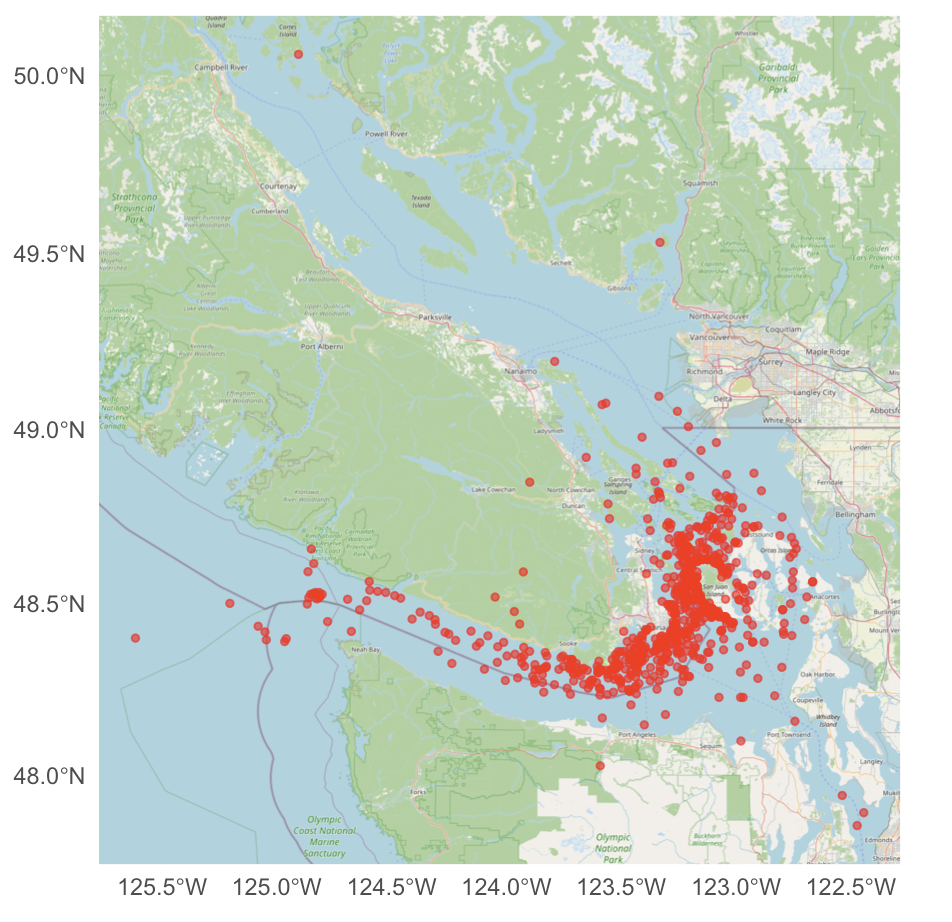
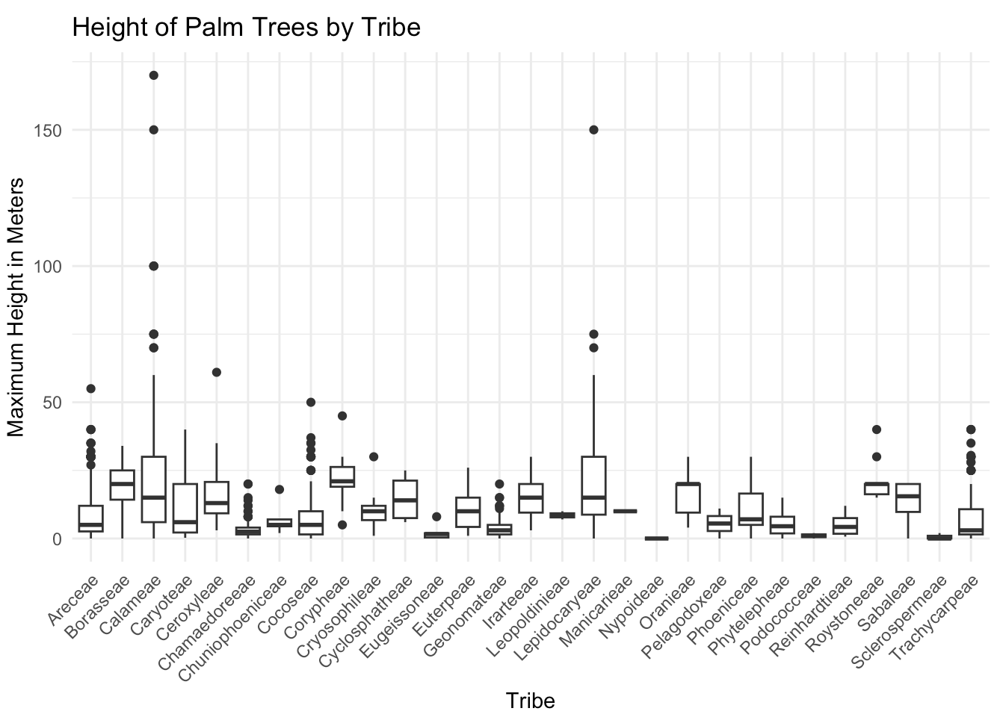

This site was created as an assignment for the **Foundations of Data Science in R** course taught by **Professor Jo Hardin** at Pomona College. 

The visualizations were generated by me when I audited the class in the fall of 2026. I absolutely loved the course! I am indebted to Professor Hardin, who gracefully allowed my unusual presence in her classroom. I am also grateful to my students, Ava Santos-Volpe and Ryan (bRyan) Mooney, who insisted that I take this class; they knew I would enjoy it.

The visualizations presented here represent assignments designed for students to learn various data science concepts.

{#fig-mylabel width="25%" placement=H"}
{#fig-mylabel width="35%" placement=H"}
{#fig-mylabel width="35%" placement=H"}
