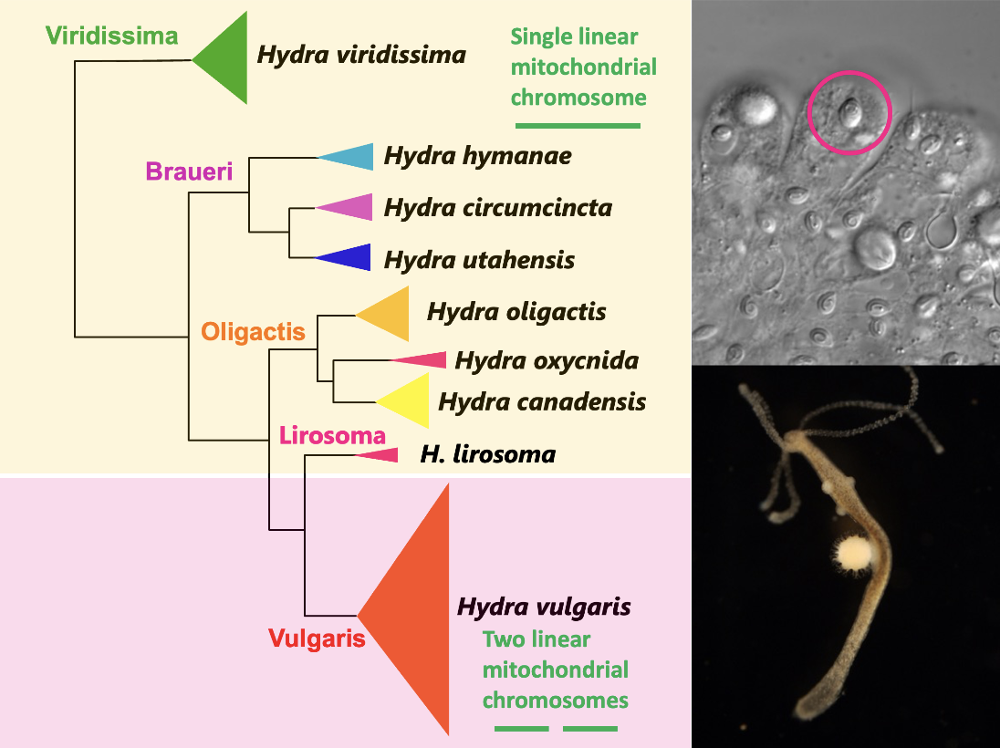

```{r}
#| echo: false
library(tidyverse)
library(openintro)
library(dplyr)
library(stringr)
library(tidyr)
library(ggplot2)
library(ggwordcloud)
library(tidytext)
library(RColorBrewer)
library(ggtext)
# To see all available palettes, run:
# display.brewer.all()
```
---

## What is a hydra?

Hydra are freshwater invertebrates belonging to the phylum Cnidaria, a group that also includes corals, sea anemones, and jellyfish. While the vast majority of cnidarians are marine, hydras are among the few species adapted to freshwater environments. Within the class Aplanulata—which is characterized by the absence of the typical planula larva stage found in other hydroids—all species of Hydra are classified into their own dedicated family, Hydridae. 

## Hydra species and clades

We studied the phylogenetic relationships among different species of *Hydra* using molecular markers, primarily the Internal Transcribed Spacers (ITS-1 and ITS-2) of ribosomal DNA. We identified nine distinct *Hydra* species: *Hydra viridissima, Hydra utahensis, Hydra circumcincta, Hydra hymanae, Hydra oligactis, Hydra canadensis, Hydra oxycnida, Hydra lirosoma,* and *Hydra vulgaris*. These species group into five distinct clades: **Viridissima**, **Braueri**, **Oligactis**, **Lirosoma**, and **Vulgaris**. 

The **Viridissima** clade includes the "green" hydra, which harbor intracellular green unicellular algae within their endodermal epithelial cells, while the remaining four clades comprise "brown" hydra. While the vast majority of animals possess a single, circular mitochondrial chromosome, linear mitochondrial genomes have evolved independently in a few specific lineages including hydras, box jellyfish and calcareous sponges. In the **Vulgaris** clade of hydra the mitochondrial genome is split into two linear chromosomes (each roughly 8 kb in size). In the other four clade, there is a single linear chromosome of ~16 kb. 

 A key for identifying these *Hydra* species can be found here. To read more about all described *Hydra* species, follow this link.


{#fig-mylabel width="100%" placement=H"}


