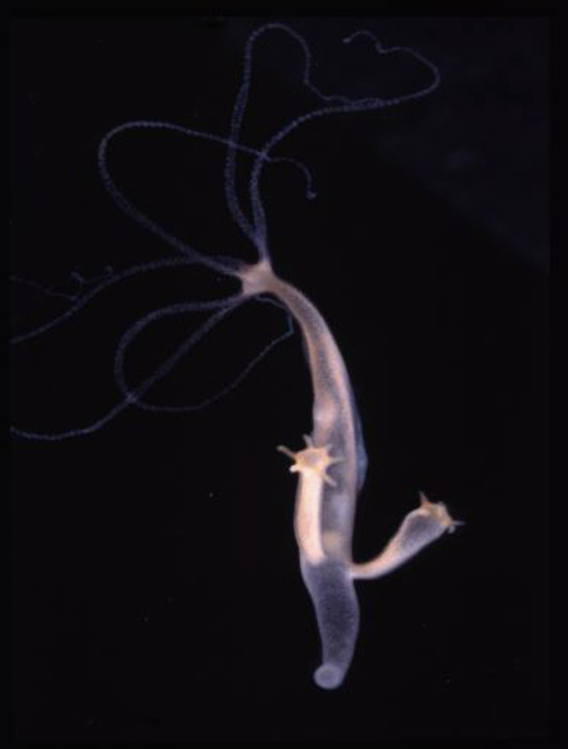
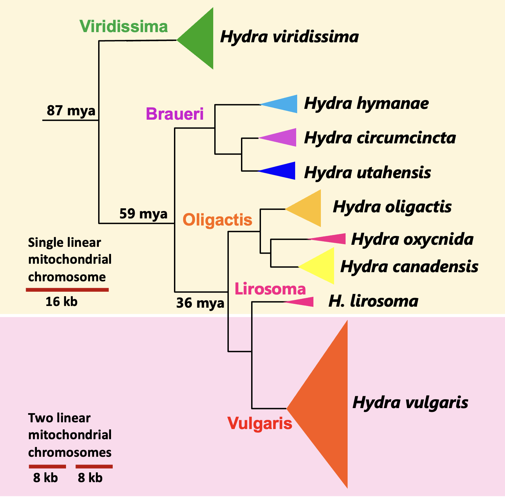

```{r}
#| echo: false
library(tidyverse)
library(openintro)
library(dplyr)
library(stringr)
library(tidyr)
library(ggplot2)
library(ggwordcloud)
library(tidytext)
library(RColorBrewer)
library(ggtext)
# To see all available palettes, run:
# display.brewer.all()
```

---
## Hydra species and clades



Hydras are freshwater invertebrates belonging to the phylum Cnidaria, a group of animals that also includes corals, sea anemones, and jellyfish. While the vast majority of cnidarians are marine, hydras are among the few species adapted to freshwater environments. Within the class Aplanulata—which is characterized by the absence of the typical planula larva stage found in other hydroids—all species of the Genus *Hydra* are classified into their own dedicated family, Hydridae. Widely distributed across the globe, hydras inhabit ponds, lakes, and rivers. Although they thrive best in cold water, different species exhibit varying degrees of tolerance to warmer environments. As carnivorous predators, they feed on small crustaceans, insect larvae, and even fish fry. Hydra reproduce both sexually and asexually (by budding). Some species are gonochoristic (dioecious) with male or female individuals, while most hydras are hermaphroditic producing both testes and eggs. 

[Tens of different species](list.qmd) of hydras have been proposed based on morphological characters and geographical origin. However, molecular phylogenies suggest that the number of species is rather small. We have identified nine distinct species: *Hydra viridissima, Hydra utahensis, Hydra circumcincta, Hydra hymanae, Hydra oligactis, Hydra canadensis, Hydra oxycnida, Hydra lirosoma,* and *Hydra vulgaris*. 

The nine hydra species maybe grouped into five distinct clades [(see Campbell's groups)](groups.qmd): **Viridissima**, **Braueri**, **Oligactis**, **Lirosoma**, and **Vulgaris**. The **Viridissima** clade includes the "green" hydras, which harbor intracellular green unicellular algae within their endodermal epithelial cells, while the remaining four clades comprise the "brown" hydras. Interestingly, the genomes of the brown hydras are approximately three times the size of the genomes of the green hydras as the result of the expansion of long interspersed nuclear elements, mostly of a single family of the chicken repeat 1 (CR1) class (Wong et al. 2019).


While most animal taxa feature a single, circular mitochondrial chromosome, linear mitochondrial genomes have evolved independently in a few lineages, including hydras, box jellyfish, and calcareous sponges. In the **Vulgaris** clade of hydras the mitochondrial genome is split into two linear chromosomes (each roughly 8 kb in size). In all the other four clades, there is a single linear chromosome of ~16 kb. 


Click on the figure if you want to enlarge it to observe it in more detail

<div style="clear: both;">
  
</div>


 The [distribution of hydra](dist.qmd) species throughout the world is quite interesting. While all nine species can be found on continents derived from Laurasia, only two species—*H. viridissima* and *H. vulgaris*—natively inhabit the southern hemisphere continents derived from Gondwana[^1]. This observation led Martínez et al. (2010) to suggest that hydras evolved in Laurasia, a hypothesis supported by the current estimated times of divergence among Hydra clades (Wong et al. 2019). Furthermore, these two Southern Hemisphere species appear to exhibit a higher tolerance to elevated temperatures, which may explain their broader global distribution.


***
Martínez D.E. , A.R. Iñiguez; K.M. Percell; J.B. Willner; J. Signorovitch; R.D. Campbell, 2010. Phylogeny and biogeography of Hydra (Cnidaria: Hydridae) using mitochondrial and nuclear DNA sequences. *Molecular Phylogenetics and Evolution* **57** (20): 403-410.

Wong W.Y., O. Simakov, D.M. Bridge , P. Cartwright , A.J. Bellantuono , A. Kuhn , T. Holstein , C. David , R.E. Steele , D.E. Martínez, 2019. Expansion of a single transposable element family is associated with genome size increase and radiation in the genus Hydra. *Proc.  Natl. Acad.  Sci. USA.* **116** (46): 22915–22917. 


[^1]: Laurasia and Gondwana are the two giant landmasses that formed when the ancient supercontinent Pangaea split apart roughly 200 million years ago.

