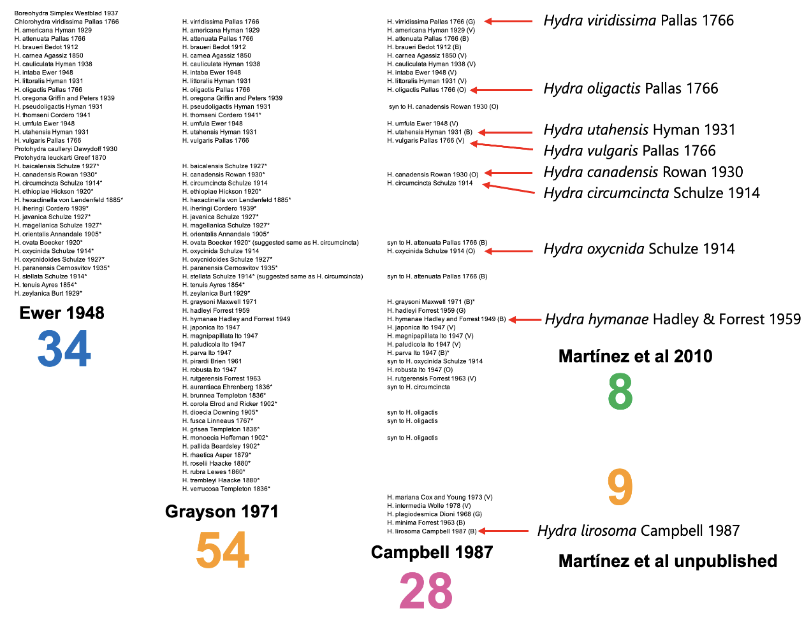

***
## Hydra lists

Many new species of hydra have been proposed since the first hydra, *Hydra oligactis*, was described by **Antonie Philips van Leeuwenhoek** in a letter sent to the Royal Society of London in 1702 (The letter was published in the *Philosophical Transactions of the Royal Society of London* a year later--Van Leeuwenhoek, 1703). Unfortunately the few distinct morphological traits of hydra make it difficult to distinguish between species and consequently to describe new ones. Thus, one is tempted to assume that many new species were proposed simply based on their geographical origin.   The figure below shows three lists of species from papers by Ewer (1948), Grayson (1971), and Campbell (1987). The number of "valid" species included in these lists varies significantly. Phylogenetic work using molecular markers and including more than 102 strains collected from around the world, suggests that the number of species maybe much smaller at around 9 (Martínez et al. 2010). 

{#fig-mylabel fig-cap="" width="100%"}
&nbsp;

Peter Simon Pallas (1741–1811) was a prominent German zoologist and botanist who spent a large portion of his career working in the Russian Empire. He is widely recognized as one of the great naturalists and explorers of the 18th and early 19th centuries.

--- 
Campbell, R. D. (1987). A new species of Hydra (Cnidaria: Hydrozoa) from North America with comments on species clusters within the genus. Zoological Journal of the Linnean Society, 91, 253–263.

Ewer, R. F. (1948). A review of the Hydridae and two new species of Hydra from Natal. Proceedings of the Zoological Society of London, 118(1), 226–244.

Grayson, R. F. (1971). The freshwater hydras of Europe. I. A review of the European species. Archiv für Hydrobiologie, 68, 436–449.

Van Leeuwenhoek, A. (1703). Part of a Letter from Mr Antony van Leeuwenhoek, F. R. S. concerning Green Weeds Growing in Water, and Some Animalcula Found about Them. Philosophical Transactions of the Royal Society of London, 23(283), 1304–1311.
