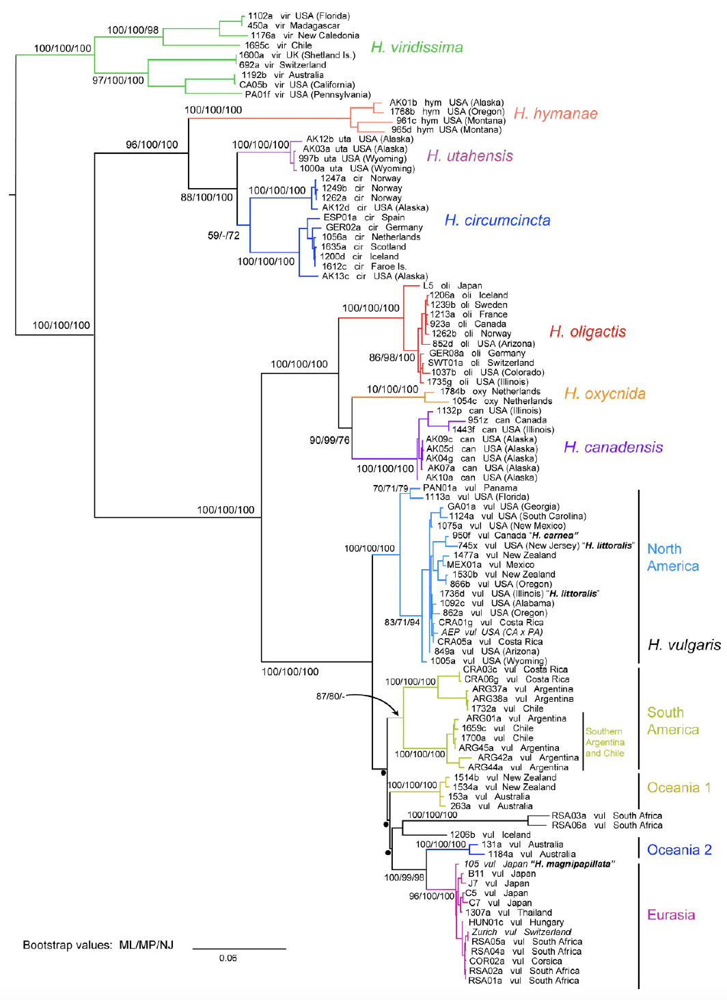

## Phylogenetic trees

Arguably the most comprehensive molecular phylogeny of the genus *Hydra* to date was published by Martínez et al. (2010). Their study evaluated 102 strains—primarily collected from wild populations, alongside widely used laboratory strains such as **105**, **Zurich**, and **AEP**. Notably, the analysis also incorporated strains sampled directly from the type localities of *H. carnea* and *H. littoralis*. While readers are strongly encouraged to consult the full paper, key findings are summarized below:

1. Green and brown hydras represent two distinct monophyletic groups and are sister lineages. 
2. Within the brown hydras, **Oligactis** and **Vulgaris** are sister lineages, while **Braueri** is the most early-diverging.
3. Eight distinct clades were found which correspond to 8 morphologically described species. They are: *Hydra viridissima, Hydra utahensis, Hydra circumcincta, Hydra hymanae, Hydra oligactis, Hydra canadensis, Hydra oxycnida* and *Hydra vulgaris*. 
4. Campbell's (1987) clustering of hydras into four groups is supported by this phylogeny; that is, the groups represent true clades (groups of hydra sharing a common ancestor). 
5. The **Viridissima Group** includes all green hydra,  *H. viridissima* The **Braueri group** includes *H. hymanae, H. utahensis,* and *H. circumcincta*. The **Oligactis group** includes *H. oligactis, H. canadensis,* and *H. oxycnida*. And the **Vulgaris group** includes *H. vulgaris*.  Also included in this group are *H. carnea, H.littoralis,* and *H. magnipapillata strain 105*. These species are nested well inside the group and cannot be distinguished from other strains; nothing in the tree suggests that they should be considered a different species.
6. Since its description by Schulze (1914), *H. circumcincta* has been considered a European hydra. However, its discovery in Alaska suggests that  *H. circumcincta* may have a circumpolar distribution.
7. Only two of the nine species of hydras, *H. viridissima* and *H. vulgaris*,  occur on continents derived from Gondwana—landmasses that today contain large territories south of the Equator[^1]. 
8. Based on that observation (7.), the authors suggest an important hypotheses: Hydras originated in Lauratia and the only two species capable of colonizing the Gondwana-derived continents were *H. viridissima* and *H. vulgaris* because of their higher tolerance to temperature (Bosch et al. 1988, Gellner et al. 1992, Ye el at. 2019). 
8. 

---
Please click on the phyologram to enlarge it and look at specific details. 

{.lightbox fig-alt="Clades" style="width: 100%; display: block; margin-left: auto; margin-right: 10;"}

***

Bosch, T. C. G., Krylow, S. M., Bode, H. R., & Steele, R. E. (1988). Thermotolerance and synthesis of heat shock proteins in the freshwater cnidarian Hydra. *Proceedings of the National Academy of Sciences*, **85**(21), 7927–7931. [https://doi.org/10.1073/pnas.85.21.7927](https://doi.org/10.1073/pnas.85.21.7927)

::: {.fragment}
::: {style="padding-left: 2rem; padding-right: 2rem; font-size: 0.9rem"}
A classic comparative study establishing that *Hydra oligactis* lacks an inducible heat-shock response (HSR) and is extremely sensitive to elevated temperatures (disintegrating above 24–33°C), whereas *Hydra attenuata (H. vulgaris)* synthesizes major heat-shock proteins (Hsps, notably Hsp60 and Hsp70) and acquires thermotolerance following pre-incubation at sub-lethal elevated temperatures. [AI Gemini]
:::

Gellner, K., Praetzel, G., & Bosch, T. C. G. (1992). Cloning and expression of a heat-inducible hsp70 gene in two species of Hydra which differ in their stress response. *European Journal of Biochemistry*, **210**(3), 683–691. [https://doi.org/10.1111/j.1432-1033.1992.tb17469.x](https://doi.org/10.1111/j.1432-1033.1992.tb17469.x)

::: {.fragment}
::: {style="padding-left: 2rem; padding-right: 2rem; font-size: 0.9rem"}
Investigates the molecular mechanics underlying the divergence in thermal tolerance between *H. vulgaris* and *H. oligactis*, demonstrating transcriptional differences in hsp70 expression under thermal stress.[AI Gemini]
:::

Martínez, D. E., Iñiguez, A. R., Percell, K. M., Willner, J. B., Signorovitch, J., & Campbell, R. D. (2010). Phylogeny and biogeography of *Hydra* (Cnidaria: Hydridae) using mitochondrial and nuclear DNA sequences. *Molecular Phylogenetics and Evolution*, **57**(1), 403–410. [https://doi.org/10.1016/j.ympev.2010.06.012](https://doi.org/10.1016/j.ympev.2010.06.012)

Schulze, P. (1914). Bestimmungstabelle der deutschen Hydraarten (Vorläufige Mitteilung). *Sitzungsberichte der Gesellschaft Naturforschender Freunde zu Berlin*, 1914(9), 395–398.

Ye, S., Badhiwala, K. N., Robinson, J. T., Cho, W. H., & Siemann, E. (2019). Thermal plasticity of a freshwater cnidarian holobiont: detection of trans-generational effects in asexually reproducing hosts and symbionts. *The ISME Journal*, **13**(8), 2058–2067. [https://doi.org/10.1038/s41396-019-0413-0](https://doi.org/10.1038/s41396-019-0413-0)

::: {.fragment}
::: {style="padding-left: 2rem; padding-right: 2rem; font-size: 0.9rem"}
Explores the upper thermal limits and acclimation dynamics in Hydra viridissima (green hydra). The paper measures critical thermal maxima (CTM) and disintegration times at 37–38°C, assessing how host-symbiont interactions (symbiotic vs. aposymbiotic states) and thermal history alter whole-organism heat tolerance.
:::

[^1]: The notable exception is the subcontinent of India which was also derived from Gondwana but is currently attached to Eurasia which was derived from Laurasia. 